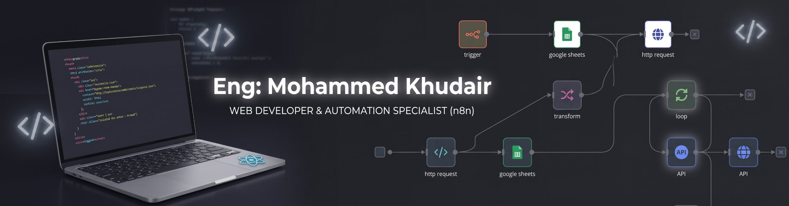

 

  

  

## ✨ About Me

> I build **clean, fast and responsive web interfaces** and design **smart n8n workflows** that connect APIs, Google Sheets and AI tools, so repetitive manual work runs on its own and saves real time.

 
 

<table width="100%">
  <tr>
    <th align="center" width="33%">🌐 Front-End</th>
    <th align="center" width="33%">🤖 Automation</th>
    <th align="center" width="33%">🧰 Tools</th>
  </tr>
  <tr>
    <td
